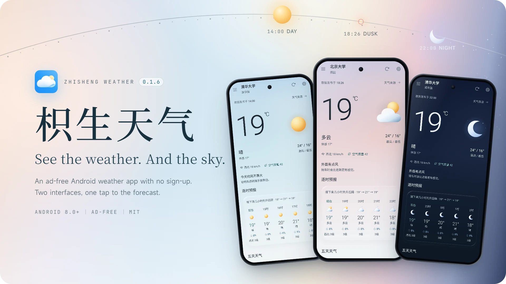
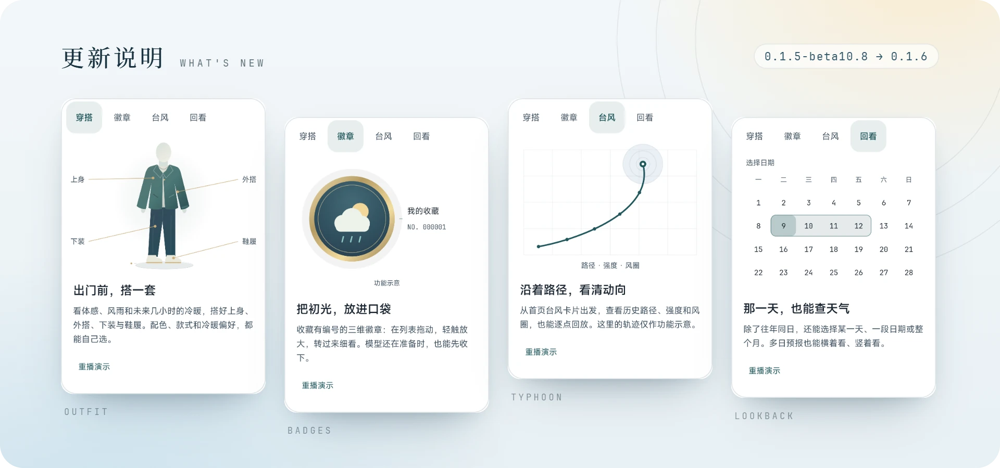
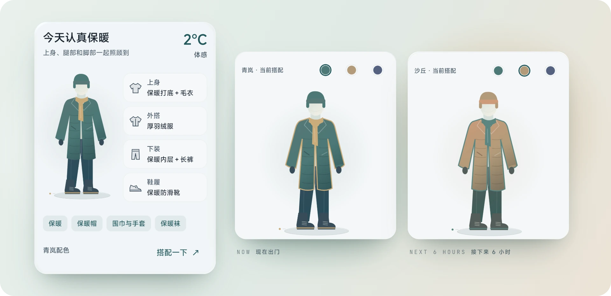
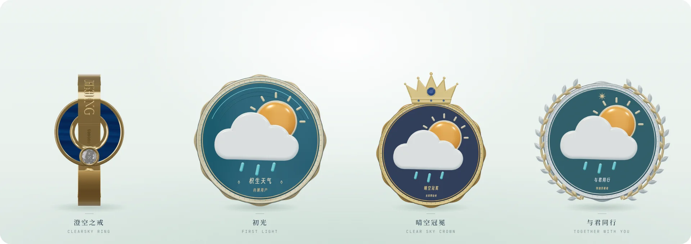
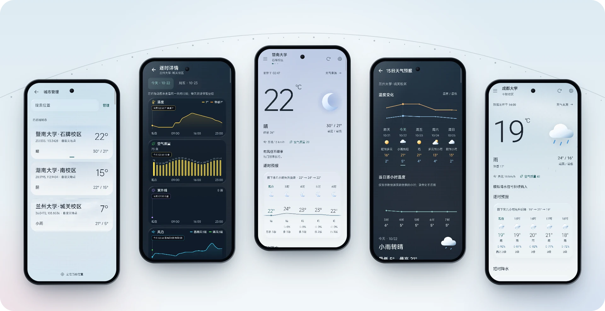
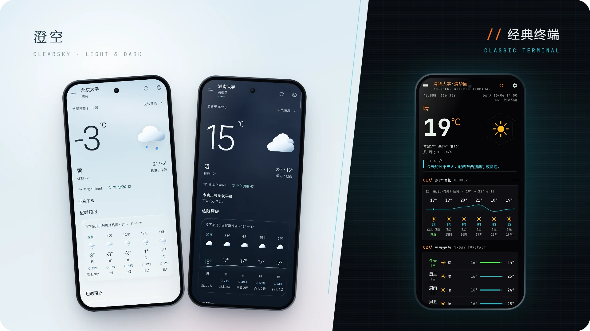
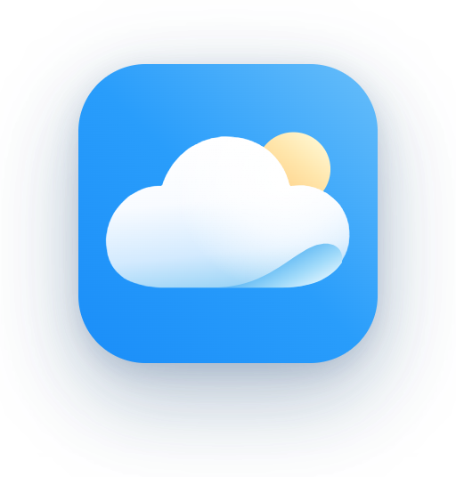
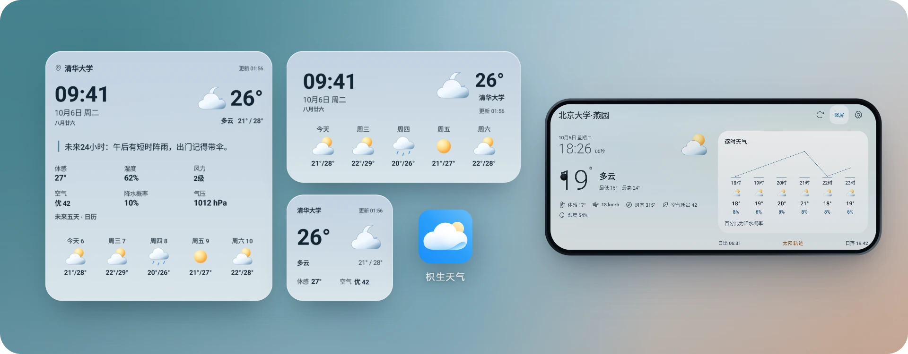
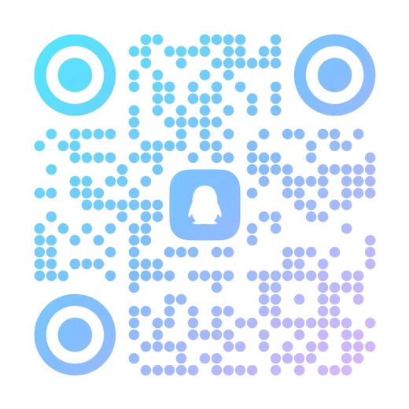

<p align="center">
  <picture>
    <source media="(prefers-color-scheme: dark)" srcset="assets/readme/cover-en-dark.webp">
    
  </picture>
</p>

<p align="center">
  <a href="https://gitee.com/zhisheng8888/ZhishengWeather/releases/download/v0.1.6/ZhishengWeather-v0.1.6-public.apk"></a>
  &nbsp;
  <a href="https://github.com/zhishengplus/ZhishengWeather/releases/latest"></a>
</p>

<p align="center">
  <a href="https://github.com/zhishengplus/ZhishengWeather/stargazers"></a>
  <a href="https://github.com/zhishengplus/ZhishengWeather/releases/latest"></a>
  
  
  <a href="LICENSE"></a>
</p>

<p align="center">
  <a href="README.md">简体中文</a> · <b>English</b> · <a href="https://zhishengweather.site">Website</a> · <a href="RELEASE_NOTES.md">Release notes</a>
</p>

<br>

When I open a weather app, I want a few answers fast: how warm it is right now, when the rain starts, what to wear, and whether the next couple of days turn cold. Zhisheng Weather puts all of that in one scrolling feed, with no splash ads and no sign-in.

If a source doesn't return a number, the field stays empty instead of being filled with an estimate, and the details always show which source each reading came from. The app's interface is in Simplified Chinese, with Japanese as an option.

## What's new in 0.1.6

<p align="center">
  
</p>

From 0.1.5-beta10.8 to 0.1.6: an outfit planner on the home page, 3D collectible badges, richer typhoon tracks, and weather lookback for any date. The cards above are the app's own release notes.

### Dress for the day before you leave

<p align="center">
  
</p>

The outfit module reads the feels-like temperature, rain, snow, gusts, UV and active warnings, along with how warm the next six hours will be, then picks a top, an outer layer, bottoms and shoes. Switch among three palettes, swap items of the same warmth, and tell it how active you'll be and whether you run warm or cold. Every suggestion expands to show its reasoning. The module sits on the home page of both interfaces, can be reordered or hidden, and uses only weather data the app already has, with no extra network calls.

### First Light, in your pocket

<p align="center">
  
</p>

Badges are 3D collectibles you can turn in your hand. Drag one in the list to rotate it, tap to enlarge it, and read both faces up close; each carries its own serial number. While an event is open you can claim First Light. You can accept a badge before its model finishes downloading, and retry any single badge that fails to load. Save your recovery codes from the menu before you uninstall or switch phones. First Light and the ClearSky Ring can also carry an ID of your choosing.

### Follow the storm

Open the typhoon card on the home page to see current positions, forecasts and past tracks. Look storms up by year or name, replay a track point by point, check the wind radii, and switch between a standard map and satellite imagery. Track data comes from the Zhejiang Water Resources Department's real-time typhoon system, and the base maps are provided by Tianditu.

### Any day, on the record

Weather lookback now goes beyond the same day in past years: pick a single date, a date range or a whole month, leap days included. Multi-day forecasts read horizontally or vertically, and the app remembers which one you prefer.

<details>
<summary><b>Other improvements in 0.1.6</b></summary>
<br>

- More hourly and multi-day forecast coverage, with fixes for stale, missing or mismatched weather conditions; alerts are no longer cut off after three
- Hong Kong and Macau place search understands traditional and simplified spellings and common aliases, and keeps the actual data source
- Smoother city search, city swiping and GPS retries; a city you pick by hand is no longer replaced by automatic location, and refreshing the same city keeps your place in the page where possible
- Less redundant drawing on the home page, outfit and badges, for smoother scrolling on high-refresh screens with the same sharpness and motion
- A new concentric sun-and-moon arc, plus fixes for moon-phase shading, jumpy hourly rows in the classic interface and a clipped header
- Long-press shortcuts no longer report the app as missing; widgets and reminders save settings and schedule refreshes more reliably; the single-row Time Weather widget is resized

The full notes, in Chinese, are in [RELEASE_NOTES.md](RELEASE_NOTES.md).

</details>

## Today, and what comes next

<p align="center">
  
</p>

<p align="center"><sub>City management · Hourly details · Home · 15-day forecast · Rainy home page</sub></p>

**Weather**

- Current conditions, feels-like temperature, wind, humidity, pressure, visibility and air quality; the weather girl tells you in one line whether to bring an umbrella, or you can switch her to plain text or turn her off
- Hourly details by date, with charts for temperature, air quality, UV and wind; gaps stay gaps, and "now" is never borrowed from a forecast
- A 5-day glance on the home page, a 15-day trend view, and yesterday's weather for comparison
- Two-hour precipitation that says when rain starts and stops; when the next two hours stay dry, the rain card opens a round of Sky Bird
- Weather alerts colored by severity, shown first and listed in full
- Sunrise, sunset, moon phase, moonrise and moonset, drawn together on a sun-and-moon arc

**Cities and location**

- Swipe left or right on the home page to change cities; neighbors show their last data right away instead of a blank page
- Bundled administrative place names, searchable offline by Chinese characters, pinyin or initials, with separate domestic and overseas search
- Locate yourself, or add a precise spot with province and city filters or coordinates
- Favorite cities stay on top, and a city you pick by hand is never swapped out by automatic location

**Reminders and refresh**

- A morning forecast for today, an evening forecast for tomorrow, and short-term rain reminders, scheduled to the minute
- Automatic refresh every 5 to 30 minutes while the app is open, plus optional background refresh
- An optional persistent notification with current conditions and the next three days

## ClearSky or Classic, your call

<p align="center">
  
</p>

ClearSky (澄空) is the default interface. Its sky follows the weather and the hour, from dawn and daylight through golden hour, afterglow and blue hour. It comes in light, dark and follow-system modes, with a choice of borderless or glass surfaces. Classic Terminal (经典终端) keeps the original phosphor-terminal look: a black background, hairlines, cyan signals and orange accents, with denser information.

Both interfaces share the same data and settings. Home modules can be reordered or hidden, the weather ambience can be turned up, down or off, and the interface language is Simplified Chinese or Japanese.

<p align="center">
  
  &nbsp;&nbsp;&nbsp;
  
</p>

<p align="center"><sub>The default icon and the weather-girl icon; switch between them under Appearance in settings</sub></p>

## A patch of sky on your home screen

<p align="center">
  
</p>

Each interface has five home-screen widgets. ClearSky offers 时光气象 (time and weather), 天气小窗 (now), 逐时天光 (hourly), 日历天气 (calendar) and 天气全景 (panorama); Classic offers 时间信号, 微型观测站, 出行监测, 五日趋势 and 气象终端. Choose what each widget shows, size numbers and labels separately, and pick a transparent or solid background. Tapping the time can open your system clock.

Turn on the landscape standby screen, and your phone becomes a weather clock when you turn it sideways.

<p align="center"><sub>All screenshots come from the app itself, at public campus coordinates; the banner and some screens use the app's built-in weather effect preview.</sub></p>

## Where the weather comes from

It works without any API key. In settings, choose Auto, the Zhisheng source or a fixed primary source, pick sources per module, and set the order used to fill missing data.

| Source | Setup | Main data |
|:--|:--|:--|
| Xiaomi public weather API | None | China weather, city search, yesterday's weather |
| National Meteorological Center (China) | None | Station observations, 7-day and 3-hourly forecasts, air quality for some stations |
| Tencent Weather | None | City weather, 48-hour and daily forecasts, life indices |
| weather.com.cn | None | City weather, 7-day and 3-hourly forecasts, some air quality and indices |
| Open-Meteo | None | Global model conditions, hourly and daily forecasts, air quality, 15-minute precipitation, and the archive behind weather lookback |
| Zhejiang typhoon track system | None | Northwest Pacific typhoon positions, tracks, intensity, wind radii and multi-agency forecasts |
| QWeather | Your JWT or API key | Conditions, alerts, hourly and daily forecasts, minute precipitation, air quality, life indices |
| Caiyun Weather | Your token | Conditions, hourly and daily forecasts, minute precipitation, air quality, alerts |
| Amap / Baidu | Your key or AK | District weather; Amap also improves street search and address lookup |
| Seniverse / Moji | Your subscription | Current weather and daily forecasts, depending on your plan |

- **Choosing**: Auto reads several public sources at once and uses the freshest valid current conditions. Other sources only fill fields the primary source left empty, and filled values are labeled. There's no weighted averaging across sources, and agreement between sources is not treated as accuracy.
- **Filling gaps**: hourly values match the same local hour and daily values the same local date. Values the primary source already has, including zero precipitation, are kept, and pressure readings on different bases are never mixed.
- **Personal credentials** stay on your device, are left out of backups, and never ship in the public APK.

For decisions about safety, follow the warnings issued by your local meteorological service.

## No ads, no new account

- No ads and no third-party analytics SDK; no sign-up.
- Cities, settings and any personal credentials you enter stay on your device. Weather requests send the city name, code or coordinates to the source you chose.
- "Help improve the service" and "Device and version statistics" are on by default until you make a choice. They upload basic information such as the device model, OS and app version, screen and language, never coordinates, personal keys or search history, and each can be turned off on its own.
- The Zhisheng location service is off by default. When it's on, coordinates, accuracy and a random install ID go to the developer's server and are resolved to an address through the Amap Web service. Turning it off stops uploads, and you can delete the location history already uploaded.
- Claiming a badge uploads a random profile and install ID, the device model and a digest of the device identifier; the app never reads the IMEI or MAC address. If location permission is granted and a position is available, the latest location is attached.
- The typhoon page requests map tiles from Tianditu and does not read your device location.

The full text is in the in-app privacy notice (隐私说明). System permissions used:

| Permission | Why |
|:--|:--|
| Internet | Weather, places, badges and update checks |
| Network state | Know whether you're online |
| Install packages | Open the system installer after you download an update in settings; nothing installs silently |
| Approximate / precise location | Optional; requested only when you locate yourself; no background location |
| Notifications | Weather reminders, alerts and the persistent weather notification |
| Run at startup | Keep widgets and reminders updating after a reboot |

## Download and install

1. Download `ZhishengWeather-v0.1.6-public.apk` from [Gitee](https://gitee.com/zhisheng8888/ZhishengWeather/releases/tag/v0.1.6) (recommended) or [GitHub Releases](https://github.com/zhishengplus/ZhishengWeather/releases/latest). Both host the same file.
2. Install it on Android 8.0 or later. The "install unknown apps" prompt is the system's standard notice for APKs from outside an app store, not an extra permission the app asks for.
3. On first launch, locate yourself or pick a city. Later you can check for updates in settings; updating in place keeps your cities, settings and badges.

<details>
<summary><b>Verify the APK</b></summary>
<br>

SHA-256 for 0.1.6:

```text
68920185B20EDE8B91B31BCC45ECD041B0B1B2774CDBB51C3608226AF1A8CAB0
```

```bash
certutil -hashfile ZhishengWeather-v0.1.6-public.apk SHA256   # Windows
shasum -a 256 ZhishengWeather-v0.1.6-public.apk                # macOS / Linux
```

GitHub Releases also includes `SHA256SUMS.txt`.

</details>

## Build from source

This repository holds a key-free source export; read [SOURCE_EXPORT.md](SOURCE_EXPORT.md) before building. The current snapshot is 0.1.5-beta10.8. The 0.1.6 source hasn't been synced yet, so use the APK above if you want 0.1.6.

You need JDK 17 and Android SDK 34; the Gradle Wrapper is included.

```bash
git clone https://github.com/zhishengplus/ZhishengWeather.git
cd ZhishengWeather
./gradlew assembleDebug        # Windows: .\gradlew.bat assembleDebug
```

Export builds use a locally generated debug signature and have in-app updates turned off, so they can't install over the official public build.

<details>
<summary><b>Use your own QWeather credentials</b></summary>
<br>

Add these to `local.properties` in the project root (Git ignores this file):

```properties
sdk.dir=<Android SDK path>
qw.host=<API Host>
qw.project_id=<Project ID>
qw.kid=<Key ID>
qw.private_key=<Ed25519 private key, single line>
```

You can also skip the build change and enter them in the app under 数据接入 (data access) in settings.

</details>

Built with Kotlin 2.0, Jetpack Compose, Material 3, Coroutines and Flow, Retrofit, OkHttp, kotlinx-serialization, DataStore and WorkManager. MapLibre draws the typhoon map, and the 0.1.6 badges render with three.js in a WebView. `minSdk 26`, `targetSdk 34`. See [CONTRIBUTING.md](CONTRIBUTING.md) for code layout and commit conventions.

## Come say hi

The QQ groups are the place to talk about weather, share ideas or report problems. Group 1 is almost full, so newcomers should start with Group 2.

<table align="center">
  <tr>
    <td align="center" width="260">
      <br>
      <b>Group 2</b> · 562847192<br>
      <a href="https://qm.qq.com/q/Plez46Gzuy">Join in QQ</a>
    </td>
    <td align="center" width="260">
      <br>
      <b>Group 1</b> · 1106284779<br>
      <a href="https://qm.qq.com/q/nfpxlC4Pyo">Join in QQ</a> · <sub>almost full</sub>
    </td>
  </tr>
</table>

Reproducible bugs are welcome in [GitHub Issues](https://github.com/zhishengplus/ZhishengWeather/issues). Include the app version, phone model, Android version, data source and screenshots where they help, and blur any tokens or API keys.

## Support the project

Zhisheng Weather will stay free and ad-free. I build it because I enjoy it, and I enjoy hearing from the people who use it. If a forecast is off, a sentence reads awkwardly, or there's something you'd like next, just tell me.

If you'd like to chip in, scan the WeChat appreciation code below and leave the name you'd like to appear under. Every supporter is listed on the in-app sponsor board.

<p align="center">
  
  <br><br>
  <b>愿你出门遇晴，代码一次通过，日子风调雨顺。</b><br>
  <sub>May you step out into clear skies, pass every build on the first try, and have kind weather all year.</sub>
</p>

## Thanks

Thank you to everyone who has sent feedback in the groups, on Coolapk and in Issues. Sponsors on the live in-app board, 99 people, in that order: `秋`, `披着牛皮的糖`, `摆渡人`, `😀`, `皮`, `Sh4d0W`, `饕餮梼杌獬豸`, `&`, `追光者`, `👁_👁`, `Past-Present-Future`, `雾岛笙南`, `苍茫`, `CK`, `半夏`, `西伯利亚狼`, `豆腐佬喔`, `洛儿阿茶`, `江宁`, `浪中浮云`, `大寶`, `支持枳生的老板`, `李勇`, `bluebone`, `深海罗非鱼`, `轻轻飘过的落叶`, `一月光含千世界`, `JamoC`, `野鸭子Evan`, `白日梦想家`, `YOGA`, `Adrian`, `Mrmuscle`, `ayida999`, `关`, `AiFuL`, `人生得意`, `意难平`, `匠芯`, `钟福燕`, `∮`, `润物无声`, `ScottZzz`, `*年`, `嗷呜`, `凉粉`, `浩然一切随缘`, `十二`, `2026`, `偏我来时不逢春`, `江湖暂过住`, `亦世凡华`, `llb`, `屿光`, `阿良`, `中未⬆️`, `十三”画`, `SKY`, `PickGear`, `以后升级纯靠举报加经验太好玩了`, `GongXian`, `酷我哥哥`, `李玄子`, `风来坊`, `X_K`, `果丽橙`, `谭政成`, `赵胖胖和李瘦瘦`, `烟花易冷`, `学习鱼`, `Ali`, `玉立`, `拾玖ya`, `...`, `阮福熊`, `yukino`, `许久丶不嵩手`, `如此而已`, `小豪科1212`, `王鸣川`, `Tarachi`, `半醒时迁`, `枫宇I樵夫`, `Neuro`, `安婧Tiffany`, `释梦Supreme`, `礼子`, `Misaki`, `征服天堂`, `好事多磨`, `无糖可乐没有糖`, `wdk7527`, `白云`, `（待认领）备注写的是：感谢大佬的软件，很好用`, `（待认领）备注写的是：枳生`, `kSir`, `一只糊涂猫`, `肖智强`, `为你写诗`.

Community contributors: `PPQ1028`, `Uinuan1`, `KZzzzo`, `睡觉了寂`, `微生之最`, `r1file`, `vsqesy3721`, `茉莉羽`, `陈大橙`, `飞667`, `一杯冰美式、、`, `M1ralce`, `紅星照耀中國`, `我爱跑步`, `河鱼天雁`, `你的心里没点高数吗`, `周月星斗`, `无敌战神暴王龙`, `control3`, `明珠有泪`, `Gstar_`, `伍拾两HZ`, `寡欲老公猪`.

Weather icons derive from Meteocons, interface icons from Phosphor Icons, offline place names come from GeoNames, solar positions use commons-suncalc, and badges render with three.js. Licenses and sources are listed in [THIRD_PARTY_NOTICES.md](THIRD_PARTY_NOTICES.md).

<details>
<summary><b>Version history</b></summary>
<br>

| Version | Highlights |
|:--|:--|
| 0.1.6 | Outfits, 3D badges, typhoon tracks, lookback for any date |
| 0.1.5-beta10.8 | Swipe between cities, first-run location guide, precise places, fill order for missing data |
| 0.1.5-beta10.5 | Per-module sources, more domestic sources, morning and evening reminders, widget display options, Sky Bird |
| 0.1.5 betas | ClearSky interface, 15-day forecast, weather lookback, Japanese interface |
| 0.1.3 | Landscape weather clock, street-level location, glass widgets, weather-girl icon |
| 0.1.0 | City deck, weather ambience, five terminal widgets |
| 0.0.5 | The light "Cold Jade" theme |
| 0.0.1 | First public preview: the phosphor-terminal interface and 15 weather icons |

Full notes for every version are on [Releases](https://github.com/zhishengplus/ZhishengWeather/releases).

</details>

## License

- Code is released under the [MIT License](LICENSE). Issues and PRs are welcome.
- The interface design, app icons, the weather-girl character, badge models and app copy are Zhisheng Weather project assets; please credit the source when you use them.
- Weather data belongs to its providers and is for reference only.
- Keep personal weather-service credentials out of public repositories.

<br>

<p align="center"><sub>Zhisheng Weather · See the weather. And the sky.</sub></p>
