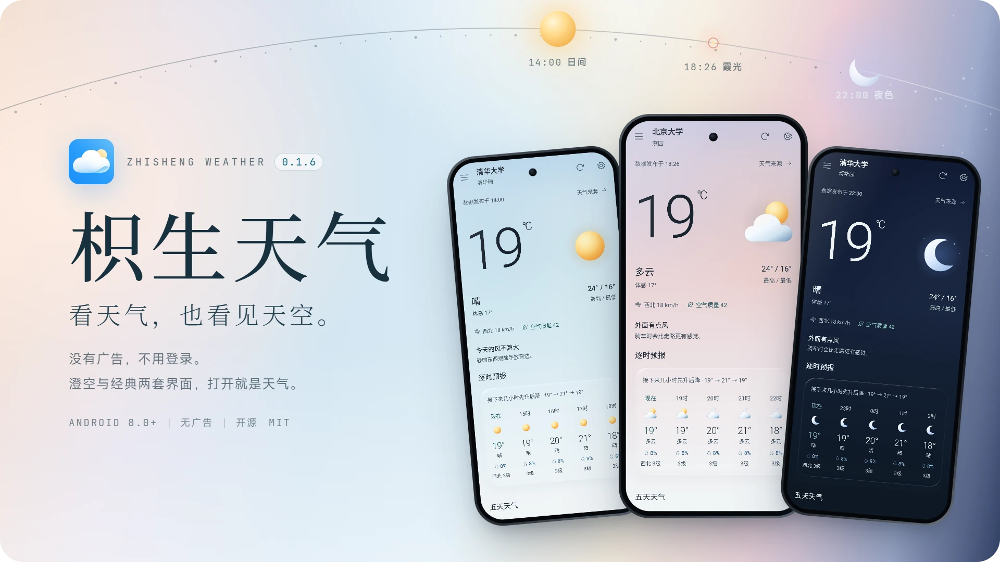
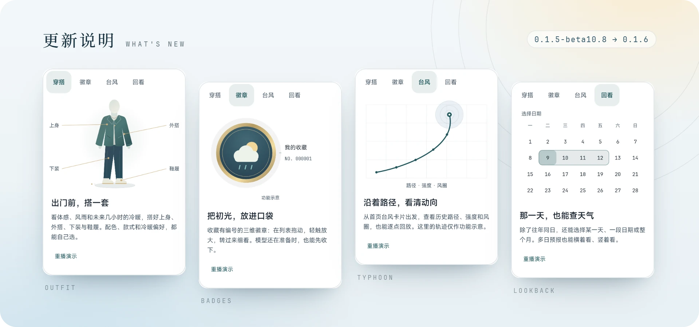
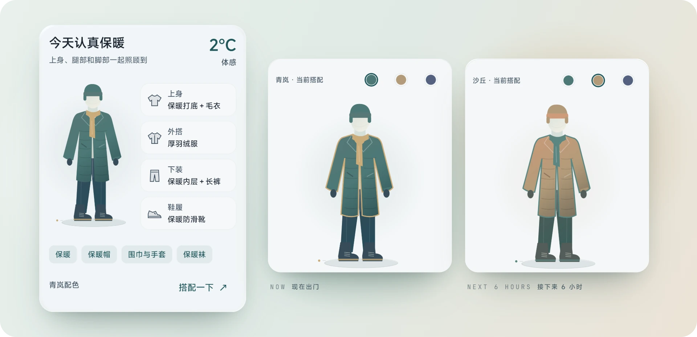
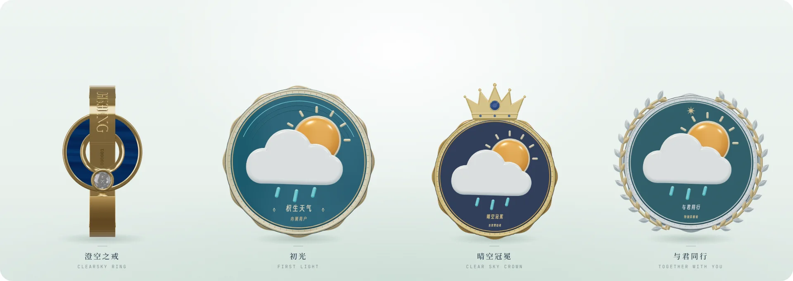
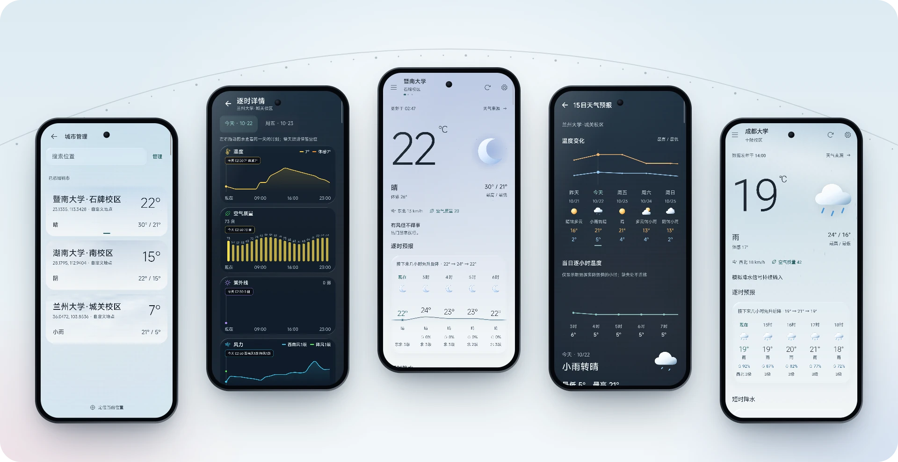
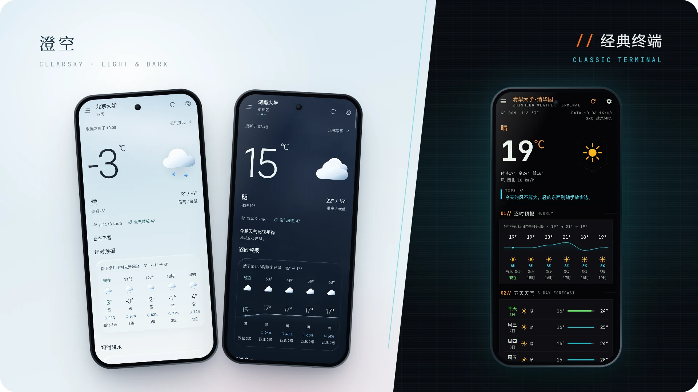
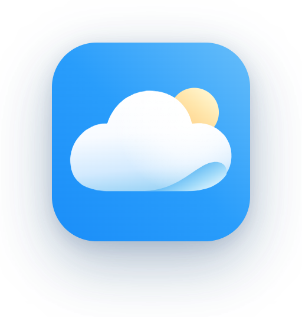
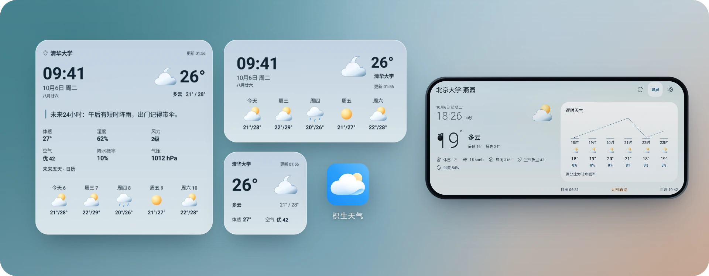

<p align="center">
  <picture>
    <source media="(prefers-color-scheme: dark)" srcset="assets/readme/cover-zh-dark.webp">
    
  </picture>
</p>

<p align="center">
  <a href="https://gitee.com/zhisheng8888/ZhishengWeather/releases/download/v0.1.6/ZhishengWeather-v0.1.6-public.apk"></a>
  &nbsp;
  <a href="https://github.com/zhishengplus/ZhishengWeather/releases/latest"></a>
</p>

<p align="center">
  <a href="https://github.com/zhishengplus/ZhishengWeather/stargazers"></a>
  <a href="https://github.com/zhishengplus/ZhishengWeather/releases/latest"></a>
  
  
  <a href="LICENSE"></a>
</p>

<p align="center">
  <b>简体中文</b> · <a href="README.en.md">English</a> · <a href="https://zhishengweather.site">官网</a> · <a href="RELEASE_NOTES.md">更新说明</a>
</p>

<br>

打开天气 App，我只想尽快知道几件事：现在多少度，什么时候下雨，出门穿什么，明后天会不会突然降温。枳生天气把这些放进同一条信息流，不用先看开屏广告，也不用登录。

数据源没给的数字就留空，不拿估算值凑满；每一项读数用的是哪个来源，都能在详情里查到。

## 0.1.6：这一版的新东西

<p align="center">
  
</p>

从 0.1.5-beta10.8 到 0.1.6，主页多了穿搭，口袋里多了徽章，台风和天气回看也能看得更远。

### 出门前，搭一套

<p align="center">
  
</p>

主页的穿搭模块会看体感、风雨雪、阵风、紫外线和预警，再结合现在或接下来 6 小时的冷暖，搭好上身、外搭、下装和鞋履。三种配色随手换，同样厚薄的单品可以互换，活动量和冷暖偏好也能调，每条建议都能展开看依据。两套界面的首页都有这个模块，可以排序或隐藏；它只用已经拿到的天气数据，不另外联网。

### 把初光放进口袋

<p align="center">
  
</p>

徽章是能拿在手里转的三维收藏：在列表里直接拖动旋转，轻触放大，正反两面都看得清，每一枚都有自己的编号。活动开放时可以领取「初光」；模型还没下载好也能先收下，哪一枚加载失败就单独重试。菜单里可以保存恢复码，卸载或换机前记得留一份；初光和澄空之戒还能改成你自己的 ID。

### 沿着路径，看清动向

从首页的台风卡片进入，可以看实况、预报和历史路径，按年份或名字找台风，逐点回放轨迹、查看风圈，还能在标准地图和卫星影像之间切换。路径资料来自浙江省水利厅台风路径实时发布系统，底图由天地图提供。

### 那一天，也能查天气

天气回看不只看往年同日，还能挑某一天、一段日期或者整个月来查，闰日也照样能选。多日预报可以横着看，也可以竖着看，应用会记住你的选择。

<details>
<summary><b>0.1.6 的其他改进</b></summary>
<br>

- 补充逐时和多日预报，修正过期、缺失和天气现象对应错误；预警不再只显示前三条
- 港澳地名搜索补上简繁写法和常用别名，并保留实际数据来源
- 改善搜索选城、左右切城和 GPS 重试；手动选择的城市不会再被自动定位换走，同城刷新时尽量停在原来的浏览位置
- 首页、穿搭和徽章减少重复绘制，高刷屏上滑动更跟手，清晰度和动效保持不变
- 新增日月同心弧，修正月相亮暗、经典界面逐时跳动和页头遮挡
- 修正长按图标误报未安装，改善小组件与提醒的设置保存和刷新调度，调整时光气象单行尺寸

完整说明见 [RELEASE_NOTES.md](RELEASE_NOTES.md)。

</details>

## 今天怎么变，接下来怎么走

<p align="center">
  
</p>

<p align="center"><sub>城市管理 · 逐时详情 · 首页 · 15 日预报 · 雨天首页</sub></p>

**天气**

- 实况、体感、风、湿度、气压、能见度和空气质量；天气娘用一句话告诉你要不要带伞，也可以换成纯文字或关掉
- 逐时详情按日期查看温度、空气质量、紫外线和风力曲线，缺数据的地方断开，不拿预报冒充现在
- 首页 5 日速览，另有 15 日趋势，昨天的天气一起对照
- 两小时短时降水写清几点开始、几点停；两小时内不下雨时，可以在降水卡片里玩一局「云间小鸟」
- 气象预警按级别着色，优先显示，多条预警完整列出
- 日出日落、月相、月出月落，用日月同心弧画在一起

**城市与定位**

- 首页左右滑动切换城市，邻近城市先显示上次的数据，不留白屏
- 随包的行政区地名支持中文、拼音和首字母离线搜索，国内和海外分开查
- 可以定位当前位置，也可以按省市筛选或输入经纬度，添加一个精确地点
- 收藏的城市排在最前；手动选的城市不会被自动定位换走

**提醒与刷新**

- 早间今日天气、晚间明日天气和短时降水提醒，时间精确到分钟
- 停在首页时每 5 到 30 分钟自动刷新，也可以开启独立的后台刷新
- 可选常驻通知，显示当前天气和未来三天

## 喜欢澄空，也可以喜欢经典

<p align="center">
  
</p>

「澄空」是默认界面。天空的颜色随天气和时辰变化，从晨曦、日间、暖金到霞光、蓝调；有浅色、深色和跟随系统三种模式，模块外观可选「无界香氛」或「流光玻璃」。「经典终端」保留最早的磷光终端风格：黑底、细线、青色信号和橙色提示，信息排得更密。

两套界面共用同一份数据和设置。首页模块可以排序和隐藏，天气氛围效果可以调强弱或关掉，界面语言支持简体中文和日本語。

<p align="center">
  
  &nbsp;&nbsp;&nbsp;
  
</p>

<p align="center"><sub>默认图标和天气娘图标，可以在设置的「外观」里切换</sub></p>

## 把一片天空，放在桌面上

<p align="center">
  
</p>

两套界面各有五款桌面小组件。澄空是时光气象、天气小窗、逐时天光、日历天气和天气全景；经典是时间信号、微型观测站、出行监测、五日趋势和气象终端。显示内容可以取舍，数字和说明文字分开调大小，底色可选透明或清晰；点击时间可以设成打开系统时钟。

打开「横屏待机界面」以后，手机横过来就是一台天气钟。

<p align="center"><sub>以上截图都来自应用本身，地点为公开的校园坐标；首屏横幅和部分画面使用了应用内的天气效果预览。</sub></p>

## 天气从哪里来

不填任何 Key 就能用。设置里可以选「自动优选」「枳生天气源」或固定一个主源，也能按模块分别选，再排一个缺失数据的补全顺序。

| 来源 | 需要配置 | 主要内容 |
|:--|:--|:--|
| 小米公开天气接口 | 不需要 | 国内天气、城市搜索、昨日天气 |
| 中央气象台 | 不需要 | 测站实况、七天与逐三小时预报、部分站点空气质量 |
| 腾讯天气 | 不需要 | 城市天气、48 小时与逐日预报、生活指数 |
| 中国天气网 | 不需要 | 城市天气、七天与逐三小时预报、部分空气质量与指数 |
| Open-Meteo | 不需要 | 全球模型实况、逐时逐日、空气质量、15 分钟降水，以及天气回看的历史档案 |
| 浙江省水利厅台风路径 | 不需要 | 西北太平洋台风的实况、路径、强度、风圈与多机构预报 |
| 和风天气 | 自己的 JWT 或 API KEY | 实况、预警、逐时逐日、分钟降水、空气质量、生活指数 |
| 彩云天气 | 自己的 Token | 实况、逐时逐日、分钟降水、空气质量、预警 |
| 高德 / 百度 | 自己的 Key / AK | 区县天气；高德还能增强街道搜索和地址反查 |
| 心知 / 墨迹 | 自己的订阅 | 当前天气和逐日预报，以订阅内容为准 |

- **怎么选**：自动优选会同时读取几路公共来源，选用时效有效的实况；其他来源只补主源缺的字段，补进来的数字标明出处。不做多源加权平均，也不把来源之间是否一致当成准确率。
- **怎么补**：逐时按同一个当地小时补，逐日按同一个当地日期补，保留主源已有的值和零降水；不同基准的气压不跨来源混用。
- **个人凭据**：只保存在本机，不进备份，也不会打进公共安装包。

涉及防灾决策时，请以当地气象部门发布的信息为准。

## 没有广告，不需要新账号

- 没有广告，也没有第三方统计 SDK；不用注册账号。
- 城市、设置和你填写的个人凭据保存在本机。查天气时，城市名称、编号或坐标会发给你选的数据来源。
- 「帮助改进服务」和「设备与版本统计」在没有保存过选择时默认开启，会上传机型、系统与应用版本、屏幕和语言等基础信息；两项可以分别关闭。
- 「枳生天气位置服务」默认关闭。开启后，坐标、精度和随机安装标识会发到开发者服务器，由高德 Web 服务解析地址；关闭后停止上传，也可以删除已经上传的位置记录。
- 领取徽章时会上传随机档案和安装标识、设备型号与设备标识摘要，不读取 IMEI 或 MAC；如果已经授权定位并取得位置，会附带最近一次位置。
- 进入台风页时会向天地图请求地图瓦片，这一页不读取设备位置。

完整内容见应用里的「隐私说明」。用到的系统权限如下：

| 权限 | 用途 |
|:--|:--|
| 网络 | 获取天气、地点、徽章和更新信息 |
| 网络状态 | 判断当前是否联网 |
| 安装应用 | 在设置里检查更新，下载后打开系统安装页；不会静默安装 |
| 大致位置 / 精确位置 | 可选，定位当前位置时才申请；不申请后台位置 |
| 通知 | 天气提醒、预警和常驻天气通知 |
| 开机启动 | 重启手机后继续更新桌面小组件和提醒 |

## 下载与安装

1. 从 [Gitee](https://gitee.com/zhisheng8888/ZhishengWeather/releases/tag/v0.1.6)（推荐）或 [GitHub Releases](https://github.com/zhishengplus/ZhishengWeather/releases/latest) 下载 `ZhishengWeather-v0.1.6-public.apk`，两边是同一个安装包。
2. 安装到 Android 8.0 及以上的手机。系统提示「允许安装未知来源应用」是安装渠道的提示，不是枳生天气额外申请的权限。
3. 首次打开时选择定位当前位置，或者手动选城。以后可以在设置里检查更新，覆盖安装会保留城市、设置和徽章。

<details>
<summary><b>校验安装包</b></summary>
<br>

0.1.6 的 SHA-256：

```text
68920185B20EDE8B91B31BCC45ECD041B0B1B2774CDBB51C3608226AF1A8CAB0
```

```bash
certutil -hashfile ZhishengWeather-v0.1.6-public.apk SHA256   # Windows
shasum -a 256 ZhishengWeather-v0.1.6-public.apk                # macOS / Linux
```

GitHub Releases 里也附有 `SHA256SUMS.txt`。

</details>

## 从源码构建


安装 JDK 17 和 Android SDK 34，用 Android Studio 打开本目录。SDK 路径由各自电脑配置。Gradle Wrapper 已包含，无须另装 Gradle。

```powershell
.\gradlew.bat :app:assembleDebug
```

macOS / Linux 使用 `./gradlew :app:assembleDebug`。无服务密钥时也可编译；需要密钥的数据源和地图功能须自行配置。可参考 `local.properties.example`，或在应用设置中添加自己的凭据。

所有变体使用开发者本机生成的调试签名，并关闭官方应用内覆盖更新。没有附带签名文件。开发包不能直接覆盖官方签名版本；请使用独立测试设备或独立配置的应用 ID。

## 修改与提 PR

从公开仓库 Fork 后新建分支，完成修改后向公开仓库提交 Pull Request。说明改了什么、如何验证；界面修改请附对比截图。参见 [贡献指南](CONTRIBUTING.md)。

穿搭建议的入口、规则和状态都在 `app/src/main/kotlin/com/zhisheng/weather/ui/home/`，主要文件为 `OutfitCard.kt`、`OutfitAdvice.kt`、`OutfitState.kt` 和 `OutfitArtwork.kt`。

```powershell
.\gradlew.bat :app:testDebugUnitTest
.\gradlew.bat :app:lintDebug
```

本目录只提供 Android 开发工程，没有附带服务器运维配置、数据库或后台账号。共享服务默认地址为不可用的示例地址；需要这部分功能时，在 `local.properties` 中填写自己的 `service.endpoint`，服务须使用受系统信任的 HTTPS 证书。徽章线上配置在 `app/src/main/assets/badges/service.json`，端点和验签公钥留空，需要自行接入兼容服务。天气的公开数据源和穿搭计算不依赖这些后台配置。

群联系方式、收款码及人员名单没有随源码提供，相关资源使用占位图。徽章演示变体只使用明确标记的公开测试材料，不对应线上账号或权益。

项目使用 [MIT 许可证](LICENSE)。第三方代码、字体、美术和地理数据的授权见 [THIRD_PARTY_NOTICES.md](THIRD_PARTY_NOTICES.md) 及各资源附带的许可证。

## 社区代码贡献

城市轮廓地图由 PickGear 贡献（PR #7）。时日预报小组件由 社区贡献者 贡献（PR #17），已保留其组件与配置入口适配。
